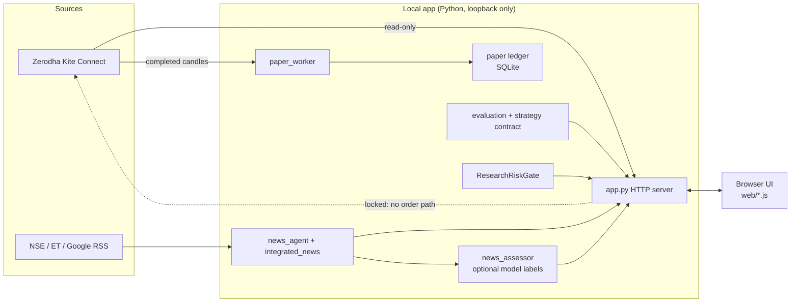

# TradeLab India

**An AI-assisted, automated paper-trading bot for Indian markets, built on Zerodha Kite Connect. Supervised live automation is the goal, and it is locked.**

[](https://github.com/pk7007/tradelab-india/actions/workflows/checks.yml)

TradeLab is a trading bot you run on your own computer. It reads completed Zerodha candles, applies a rule-based intraday strategy with cost-aware sizing, modelled stops, targets and square-off, and runs the whole session automatically as **paper trades** once you arm it. AI agents read Indian market news and label it as research context. Deterministic risk rules, not a model, make every decision. Evaluation, risk planning and a browser dashboard show the assumptions behind each idea: the data used, the costs charged, the risks modelled and the evidence still missing.

The long-term aim is a supervised, real-money auto trader. This release is not that: see the [roadmap](#roadmap) for the evidence required before live automation is considered.

> **Status: automated paper trading with AI news research. It does not place real orders and is not yet a live trading bot.**
> Live order dispatch is locked by a hard-coded constant (`LIVE_EXECUTION_READY = False` in `app.py`). No setting, environment variable or API key can unlock it in this release. No profitability has been measured or claimed. Nothing here is investment advice.

[Quick start](#quick-start) · [What it does](#what-it-does) · [Safety model](#safety-model) · [Architecture](#architecture) · [Development](#development-and-checks) · [Status](#current-status-and-known-limits) · [Roadmap](#roadmap) · [Docs](#documentation)

## What it does

| Area | What you get | Boundary |
| --- | --- | --- |
| **Auto Trading page** (`/`) | Intraday selection, session controls, positions, results and evidence in one place. | Paper only. Settings hold connection, assumptions and diagnostics. |
| **Durable paper accounts** (`/trader-paper`) | Persisted fills, costs, duplicate protection, restart recovery. Opt-in *Intraday v1*: cost-aware sizing, modelled stops and targets, volume-participation limits, observed-candle square-off. | Fills are modelled on candles, not real executions. Legacy accounts keep their old behaviour. |
| **Automated paper-trading worker** | Optional, explicitly armed worker that reads completed five-minute Kite candles for one fixed symbol. Lease fencing and a heartbeat guard it. | You arm it per session after confirming data-retention rights and a session calendar. It has no order method. |
| **Strategy evaluation** (`/trader-evaluate`) | Fixed SMA(5/20) rule, two chronological validation windows, a final holdout, a matched buy-and-hold benchmark and a doubled-cost sensitivity run. A private registry flags repeated holdout viewing. | One fixed rule. No validated edge. |
| **Research-only EMA 20/50 + ADX** | Tested indicator and signal functions (`indicators.py`, `ema_adx_strategy.py`). | Not connected to evaluation, paper trading or any order path. Defaults are unvalidated. |
| **Risk planning** | Whole-share sizing, exposure limits, remaining daily-loss checks, explicit paper-order approvals. | Limits are planning inputs, not guaranteed loss caps. |
| **News agent** | Polls NSE, Economic Times and Google News RSS on a 30-second schedule with per-source retry, freshness checks and exact NSE company mapping. | Research context only. Never changes entries, exits or limits. |
| **Optional AI news labels** | Off by default. With `TRADELAB_NEWS_AI=true` and an Anthropic key, a model labels current items (sentiment, event type, confidence). Quotes must match the article text, symbols must come from an allow-list, daily and per-cycle call caps apply, and only ids and labels are stored. | Labels carry `executionAllowed: false`. They cannot authorise or size an order. |
| **Agent catalogue and desk** | A registry of 16 implemented review responsibilities across 32 domains, with a coordinator, alerts and operations health. | Evidence checks, not trading agents. No model controls funds or risk. |
| **Broker workspace** | Account overview, holdings, positions, order book, quotes, historical candles and a manual order review flow (`/advanced`). | Read-only after you log in. Dispatch is locked. |
| **Kill and recovery paths** | `ResearchRiskGate.kill()` always returns cancel requests and exit *intents*. Fixture replay proves paper recovery across process restarts. | Nothing calls `kill()` with real positions yet. It never reports "flattened". |

## Quick start

You need **Python 3.10 or newer** (written without 3.11+ only syntax; CI tests 3.12 only) and, for the JavaScript checks, **Node.js 22**. No broker account is needed for the synthetic demo or for evaluating files you are permitted to use.

```bash
git clone https://github.com/pk7007/tradelab-india.git
cd tradelab-india
python -m venv .venv
source .venv/bin/activate          # Windows PowerShell: .\.venv\Scripts\Activate.ps1
python -m pip install -r requirements.txt
python app.py
```

Open **http://127.0.0.1:8765** and keep the terminal running. Then try the offline evaluation:

```bash
python evaluation.py --demo        # prints a report on invented prices
python scripts/fixture_recovery.py # paper restart and recovery drill, no broker
```

### Connect Zerodha (optional, you do this yourself)

1. In your Kite Connect developer console, register `http://127.0.0.1:8765/auth/kite/callback` as the redirect URL.
2. Copy `.env.example` to `.env` (git-ignored) and enter `KITE_API_KEY` and `KITE_API_SECRET` locally. Never paste them into a chat, an issue or a commit.
3. Restart the app, click **Connect Zerodha** and sign in on Zerodha's own page. Tokens stay in server memory only, so restarting clears the login.
4. Check `GET /api/status`: it should show connected and `liveExecutionReady: false`.

Before a first paper session, run the offline preflight, then follow the owner runbook.

```bash
python scripts/paper_readiness.py   # PASS / FAIL / BLOCKED checklist, no network, no secret values
```

- [Paper-run runbook](docs/paper-run-runbook.md): one supervised session from login to evidence export.
- A Kite key connects to the broker. It is not an AI credential, and no model is connected unless you opt in to news labels.

### Configuration

All settings are environment variables, usually from `.env`. Only names are listed here.

| Variable | Purpose | Default |
| --- | --- | --- |
| `KITE_API_KEY`, `KITE_API_SECRET`, `KITE_REDIRECT_URL` | Zerodha app credentials and callback | none |
| `KITE_DATA_STORAGE_APPROVED` | Set to `true` only after you confirm your right to retain Kite candles. Without it the paper worker and CSV history saving refuse to run. | off |
| `TRADELAB_ENABLE_LIVE_ORDERS` | Present for compatibility. It **cannot** unlock dispatch. | `false` |
| `APP_HOST`, `APP_PORT` | Listen address (loopback) | `127.0.0.1`, `8765` |
| `TRADELAB_DATA_DIR` and `TRADELAB_*_DB` | Private data folder and per-store database paths | local app-data folder, outside the repo |
| `TRADELAB_NEWS_AI`, `ANTHROPIC_API_KEY` | Both required to enable model news labels | off |
| `TRADELAB_NEWS_AI_MODEL`, `_CYCLE_LIMIT`, `_DAILY_LIMIT` | Model id and call caps (bad values fall back to safe defaults) | `claude-haiku-5-5`, 5 per cycle, 100 per UTC day |

Optional packages: `pip install -r requirements-ai.txt` for model labels, `pip install -r requirements-dev.txt` for the checks below.

## Safety model

1. **Live execution is locked in code.** `LIVE_EXECUTION_READY` is a constant, not a setting. The paper worker has no order method.
2. **AI is context, not authority.** News and model labels are research inputs. Deterministic risk rules decide, and a review score never authorises an order, strategy promotion or loss-limit change.
3. **Look-ahead safety.** Items become usable only at their availability time. Labels are keyed to the item revision they were made for.
4. **Untrusted input is hardened.** Feeds are decoded against an encoding allow-list before any XML check, DOCTYPE and entity payloads are rejected, article text is fenced in prompts, and model quotes must be verbatim.
5. **Secrets stay local.** Credentials live in `.env` and process memory. The app binds to loopback. Do not expose it to the internet.
6. **Fail visibly.** Source failures, stale data and storage errors are labelled, not hidden. Optional research outages must never stop exit processing, exposure reporting or reconciliation.
7. **Honest evidence.** Historical simulations assume fills and costs; liquidity, taxes, corporate actions, gaps and outages can change real results.

Keep credentials, account records, ledgers and licensed market exports out of Git. No real market dataset is bundled, and public accessibility of data does not imply redistribution rights.

## Architecture



| Path | Purpose |
| --- | --- |
| `app.py` | Local HTTP server, sessions, status and broker read requests |
| `paper.py`, `paper_worker.py`, `worker_runtime.py`, `intraday_*.py` | Durable paper ledger, Intraday v1 contract and the armed candle worker |
| `evaluation.py`, `strategy_contract.py`, `experiment_registry.py`, `validation_lab.py` | Fixed-rule evaluation, shared assumptions, result provenance, stress simulation |
| `indicators.py`, `ema_adx_strategy.py` | Research-only EMA/ADX indicators and signal |
| `research.py`, `trader_suite.py`, `portal.py` | Risk gate and `kill()`, planning tools, portal research |
| `news_agent.py`, `announcements.py`, `integrated_news.py`, `nse_filings.py` | Feed collection, NSE announcement parsing, source mapping |
| `news_intelligence.py`, `news_assessor.py` | Optional, capped, schema-validated model labels |
| `agent_*.py`, `desk_coordinator.py`, `operations.py`, `operational_alerts.py` | Review-role registry, coordinator, health and alerts |
| `automation.py`, `execution_journal.py`, `execution_controls.py` | Strategy drafts, mock execution ledger, manual intent correlation |
| `scripts/` | Fixture recovery, readiness preflight, structure check, status report, digest, audits |
| `web/` | Vanilla HTML, CSS and JavaScript interface |
| `tests/` | Offline Python and JavaScript regression tests |

Persistence is local SQLite under a private data folder. Components are separate on purpose: the paper ledger, mock execution ledger, manual execution journal and experiment registry are not yet unified into a broker-funded system.

## Development and checks

```bash
python -m pip install -r requirements-dev.txt
python -m pytest -q                                      # Python tests (CI runs the same tests via unittest discover)
for f in tests/*.test.js; do node "$f"; done            # JavaScript tests
ruff check .                                             # defects only (E9, F)
bandit -q -r . -c pyproject.toml --severity-level high   # security scan
python scripts/structure_check.py                        # read-only repository integrity check
python scripts/project_report.py                         # dated Markdown status report
```

Measured on 23 November 2026: **617 Python tests pass** (567 subtests), all **10 JavaScript test files pass**, `ruff` and `bandit` are clean and the structure check reports 0 integrity failures. GitHub Actions ([`checks.yml`](.github/workflows/checks.yml)) runs the syntax, lint, security, test, fixture-recovery and structure steps on every push. A weekly, read-only [status report](.github/workflows/status-report.yml) uploads a report as a build artifact. Dependabot and pre-commit are configured. See [tooling](docs/tooling.md).

These checks verify software behaviour. They do not establish profitability or production readiness.

## Current status and known limits

The latest dated rating is [docs/rating-2026-11-23.md](docs/rating-2026-11-23.md): about **7.3/10** as a research and paper-trading prototype, about **4.2/10** as an AI-powered trading platform, and **1.5 to 2/10** for real-money automation. It is a judgment from engineering evidence and was **not independently reviewed**. The [current-state audit](docs/current-state-audit-2026-11-23.md) lists what is fixed and what is still open.

Not yet verified or built:

- **No observed Zerodha paper session** with a real login, and no forward paper results, so no profitability evidence.
- **No real model call** and no live NSE fetch after the latest decoding changes.
- **Live-path gaps:** no broker-side protective stops, no authoritative order and position reconciliation, and nothing calls `kill()` with real positions.
- **Evaluation gaps:** one fixed strategy, no walk-forward validation, corporate-action adjustment unverified. The example results below use invented prices.
- **No LICENSE file yet.** Without one, default copyright applies. Pick a licence before inviting reuse.
- `app.py` is a large module with no direct test importing it.

### Example result (invented prices)

The [demo report](docs/evaluation-demo.json) uses 300 invented bars and a 60-bar holdout. It says nothing about Indian market performance.

| Final holdout measure | SMA strategy | Buy-and-hold |
| --- | ---: | ---: |
| Return after modelled costs | 1.08% | 2.32% |
| Maximum bar-close drawdown | 4.66% | 5.75% |
| Completed round trips | 2 | 1 |
| Return with doubled fees and slippage | 0.47% | 2.01% |

The strategy underperformed the benchmark in this fixture. Two trades establish nothing.

## Roadmap

Planned capabilities, not shipped features or dates.

| Stage | Deliverable | Evidence needed to advance |
| --- | --- | --- |
| 1. Reliable data | Permitted historical datasets and feeds; gap, timestamp and corporate-action checks | Documented provenance, usable rights, reproducible quality reports |
| 2. Strategy research | Wire a tested strategy into evaluation with exits and sizing; walk-forward validation | Results after realistic costs on untouched periods, with failed runs kept |
| 3. Forward paper trading | Several observed supervised sessions with logged abstentions and recovery | Behaviour matches the strategy contract; failures recover correctly |
| 4. Controlled live automation | Broker-side stops, reconciliation, duplicate-order prevention, a kill path wired to real positions | Reviewed operational tests, applicable broker and regulatory requirements, explicit owner configuration |
| 5. Unified control room | Research, news, positions, strategy health and alerts in one dashboard | Clear states and tested workflows |

Profitability is something to measure, not promise. Finding a weak strategy before risking money is a useful result.

## Documentation

| Guide | Contents |
| --- | --- |
| [Paper-run runbook](docs/paper-run-runbook.md) | Owner steps for one supervised Zerodha paper session |
| [Continuous paper worker](docs/continuous-paper-worker.md), [intraday readiness](docs/intraday-readiness.md) | Worker design, arming and operations |
| [News agent](docs/news-agent.md), [news labels](docs/news-intelligence.md) | Feed collection and optional model labels |
| [EMA/ADX strategy](docs/strategy-ema-adx.md) | Research-only indicator and signal definition |
| [Evaluation inputs](docs/evaluation-data.md) | Candle formats, timestamps, provenance, assumptions |
| [Market-data setup](docs/market-data-setup.md) | Broker configuration, charts, data rights |
| [Architecture](docs/architecture.md), [capability map](docs/feature-status.md) | Structure and route-by-route status |
| [Current-state audit](docs/current-state-audit-2026-11-23.md), [rating](docs/rating-2026-11-23.md) | Latest findings and scores |
| [Tooling](docs/tooling.md), [commit workflow](docs/commit-workflow.md), [decision log](docs/decision-log.md) | Checks, review gate, recorded decisions |
| [Security and privacy](docs/security-and-privacy.md) | Handling of credentials and data |

Older audits and plans remain in `docs/` as history. Where they disagree with the files above, the newer file wins.

## Contributing and security

Read [CONTRIBUTING.md](CONTRIBUTING.md) first. Include reproducible steps and tests for any calculation or execution change, and never include credentials or account data in an issue. Report security problems as described in [SECURITY.md](SECURITY.md). Project conventions for coding agents are in [AGENTS.md](AGENTS.md).

## Disclaimer

TradeLab is a personal research tool. It is not investment advice, makes no promise of returns or loss-free trading, and makes no claim of regulatory approval or compliance with exchange, SEBI or broker rules. Using it with real brokerage credentials is at your own risk.
