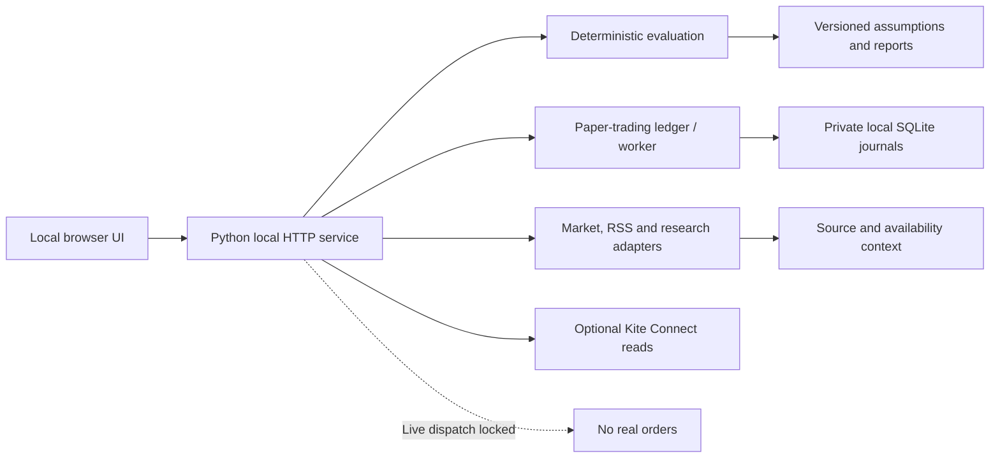

# TradeLab India — portfolio and demo tour

> **Scope:** Local-first Indian-market research and paper-trading prototype. It is **not** a production automated trading service, investment adviser, or demonstrated profitable strategy. Live order dispatch is locked.

This guide is a short, evidence-linked introduction for recruiters, reviewers and prospective contributors. For implementation details, start with [architecture](architecture.md); for capability boundaries, see [feature status](feature-status.md).

## The 30-second introduction

TradeLab India is a local browser workspace built with Python and JavaScript for studying Indian-market trading workflows. It combines market and account research, deterministic strategy evaluation, cost-aware risk planning, a durable paper-trading ledger and a source-aware news research pipeline. The engineering emphasis is reproducibility, explicit financial assumptions, lifecycle recovery and safe separation of simulated trades from broker-connected activity. Actual profitability and readiness for real-money automated execution have **not** been established.

## What a reviewer can inspect

| Area | Demonstrable behavior | Evidence and limits |
| --- | --- | --- |
| Evaluation | Run an offline synthetic SMA(5/20) evaluation with a benchmark and doubled-cost sensitivity | [Evaluation guide](evaluation-data.md) · [synthetic report](evaluation-demo.json); invented prices, not market performance |
| Paper accounts | Explore modeled fills, fees, account persistence, pause/exit controls and duplicate protection | [Continuous paper worker](continuous-paper-worker.md) · [fixture recovery](paper-feed-recovery.md); no real broker orders |
| Session workflow | Inspect source/calendar readiness, skip reasons, selection and reconciliation | [Intraday workflow](intraday-automation.md) · [readiness](intraday-readiness.md); forward-market acceptance pending |
| Market and news context | Inspect source-attributed RSS context and its availability timestamps | [News agent](news-agent.md); news does not issue trading signals; licensed integrations remain incomplete |
| Safety and recovery | Inspect live-dispatch lock, local-only binding, in-memory broker tokens, and replay regression coverage | [Security policy](../SECURITY.md) · [full audit](full-audit-2026-11-22.md); no production security certification |

## Five-minute local demonstration (no brokerage account)

Follow [development setup](development-setup.md) first. No Kite API credentials or real market data are required for this tour.

1. Start the application with the command shown in the setup guide and open **http://127.0.0.1:8765/**. Show the paper workflow's account state, risk controls, and explicitly disarmed/blocked mode.
2. Open **http://127.0.0.1:8765/trader-evaluate** and select **Run synthetic demo**. Compare the strategy with buy-and-hold, then inspect fee/slippage sensitivity. Explain that the published fixture *underperforms* the benchmark; this is a reproducibility demonstration, not proof of an investment edge.
3. Open **http://127.0.0.1:8765/trader-paper**. Explain the durable paper account model and the distinction between **Pause new entries**, **Request simulated close** and **Pause all ingestion**. Do not create an account without reviewing its own storage and assumption permissions.
4. Run the separate fixture recovery demonstration from the repository root:

   ```bash
   python scripts/fixture_recovery.py
   ```

   The script uses temporary synthetic data to demonstrate restart/overlap handling and ledger reconciliation. It does not authenticate with a broker.
5. Return to the README's [architecture overview](../README.md#architecture-at-a-glance) and explain the trust boundary: the local UI reads a Python service; simulation and research are separate from live order dispatch, which remains locked.

**Demo integrity:** Never use broker credentials, real money, private account screenshots or licensed market exports in a portfolio recording. Treat synthetic prices and any modeled returns as examples only.

## Architecture in one view



This is a **conceptual** diagram, not a claim that all modules share a single production-grade persistence or execution boundary. See [architecture](architecture.md) for the separate ledgers and present integration gaps.

## Engineering decisions worth discussing in an interview

- **Determinism versus convenience:** fixed synthetic evaluation inputs and explicit cost modeling make debugging possible; neither guarantees future performance.
- **State and recovery:** persisted paper intents, duplicate protection and simulated fill journals can be tested after process interruption, with unresolved exposure remaining visible.
- **Data provenance:** publication time, availability time and source health are not interchangeable; retrospective research must not use information before it was available.
- **Separation of authority:** research context and optional AI agents cannot override deterministic risk checks, and live dispatch stays locked.
- **Scope control:** the app is a local single-user research prototype, not a hosted broker-connected trading service.

## Recruiter-friendly project entry

**TradeLab India — Indian-market research and paper-trading workspace**

Developed a local Python/JavaScript fintech application combining strategy evaluation, explicit cost and risk modeling, durable simulated trade accounting, and source-attributed market/news research. Added offline regression coverage and recovery fixtures to test ledger consistency across interruptions. Designed the system to keep broker credentials server-side and block real-money order dispatch until separate readiness requirements are satisfied.

This is a project description, not evidence of customers, revenue, audited profitability, or live production use.

## Current boundaries and what is next

The [22 November engineering audit](full-audit-2026-11-22.md) assessed the whole requested platform at **7.2/10**, with **9/10** for the unattended offline paper workflow. These are dated engineering judgments, **not** investor returns or a fresh audit. The biggest accepted gaps are independent observed market sessions, licensed-source validation, agent workflow completion, multi-ledger recovery exercises, and real-money readiness. The product [roadmap](remaining-feature-roadmap.md) describes the associated evidence gates.

For contributors: [development setup](development-setup.md) · [contributing](../CONTRIBUTING.md) · [security](../SECURITY.md).
